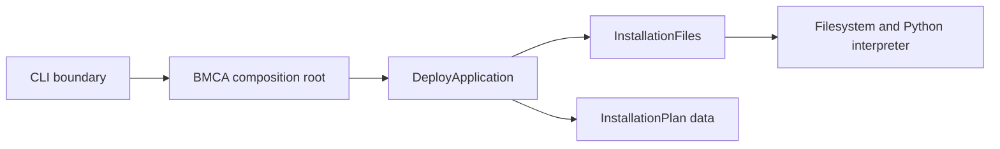

# Python application architecture

The greenfield application uses BMForge's Activity / Interface / Entity roles.
The current working use case is deployment of the identity package. CA engine
integration and certificate operations will be implemented as later use cases.

| Location | Responsibility |
| --- | --- |
| `bmca/BMCA.py` | Composition root: construct concrete interfaces and inject them into activities. Expose `BMCA.deploy(...)`. |
| `bmca/cli.py` | Parse commands, enforce the CLI privilege boundary, render results, and report failures. |
| `bmca/activity/DeployApplication.py` | Choose and retain the installation role; coordinate checks, copy, verification, and successful completion. |
| `bmca/interface/InstallationFiles.py` | Read/validate metadata and ownership records; perform filesystem, permission, and interpreter operations. |
| `bmca/entity/InstallationPlan.py` | Hold an immutable plan and result context: action, role, file lists, destination, and version. No I/O. |
| `bmca/constants/DInstallation.py` | Group payload settings, record paths, actions, and roles. |
| `bmca/constants/DBMCA.py` | Keep the canonical literal application and CMDB metadata. |

`scripts/install.py` is a small launcher. The existing shell lifecycle wrappers
invoke the same CLI; `python3 -B -m bmca` is also available. Application callers
use `BMCA.deploy(...)` and receive an `InstallationPlan` without console output.
Activities use ordinary constructor injection, with no framework or base-class
hierarchy. The interface retains the pinned installer mechanics and component
provenance marker.

Install/upgrade/uninstall semantics, role retention, payload selection, and
successful-version bookkeeping remain the same. Verification now also imports
the installed application composition root. Tests exercise real disposable file
installations through the Python API and the installed CLI without the checkout.

Future activities should call named operations on focused interfaces and pass
entities containing domain data. Add them when a use case exists. HTTP, database
access/provisioning, CA service operations, and XMR integration are not part of
this architecture checkpoint.
